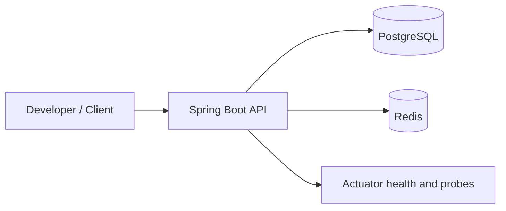

# Architecture

## Phase 1 runtime

The application is a modular monolith. PostgreSQL is the source of truth for durable platform data. Redis is included from the first milestone because later request-path rate limiting requires a low-latency shared state store. No business feature depends on Redis yet.

## Request lifecycle

1. The embedded servlet container accepts an HTTP request.
2. Spring MVC routes it to a controller.
3. Request DTO validation is performed at the boundary when applicable.
4. Controller/service code returns a response or raises an exception.
5. `GlobalExceptionHandler` maps known request errors to a stable `ApiError` response.
6. Actuator exposes operational health separately from the versioned product API.

## Design constraints

- Keep controllers thin; domain behavior belongs in services.
- Persist schema changes only through forward-only Flyway migrations.
- Disable Open Session in View.
- Use UTC timestamps in persistence.
- Do not expose exception messages or stack traces to API clients.
- Add readiness dependencies deliberately as the application gains required infrastructure.
