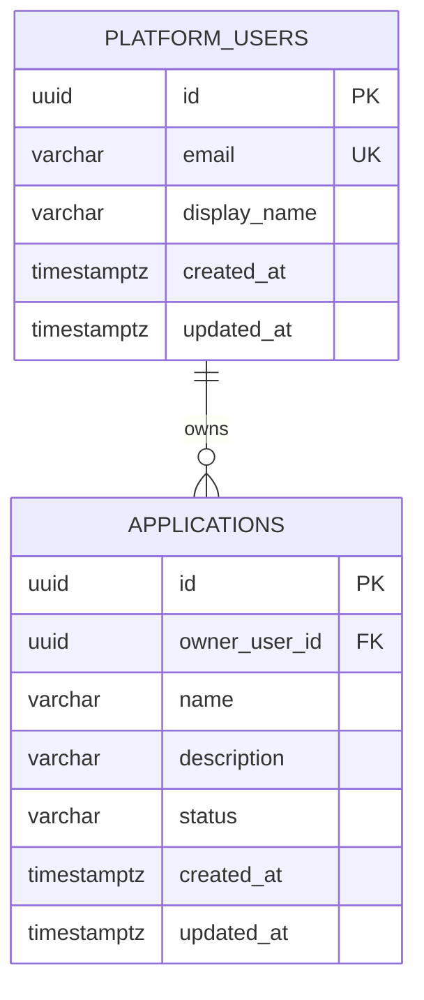

# Initial data model

Phase 1 establishes only the ownership foundation.

## Constraints

- User email is unique.
- Application names are unique per owner, not globally.
- Application status is constrained to ACTIVE, SUSPENDED, or ARCHIVED.
- An application cannot outlive its owner reference.
- Owner/creation-time index supports listing an owner's applications.

Later migrations will add API credentials, upstream definitions, routes, plan/subscription state, usage records, and durable event delivery after those workflows are specified.
